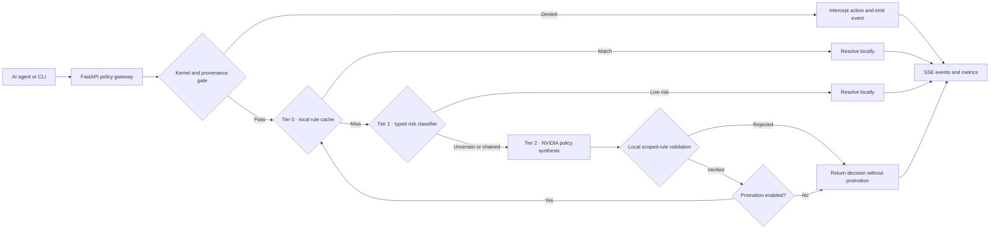
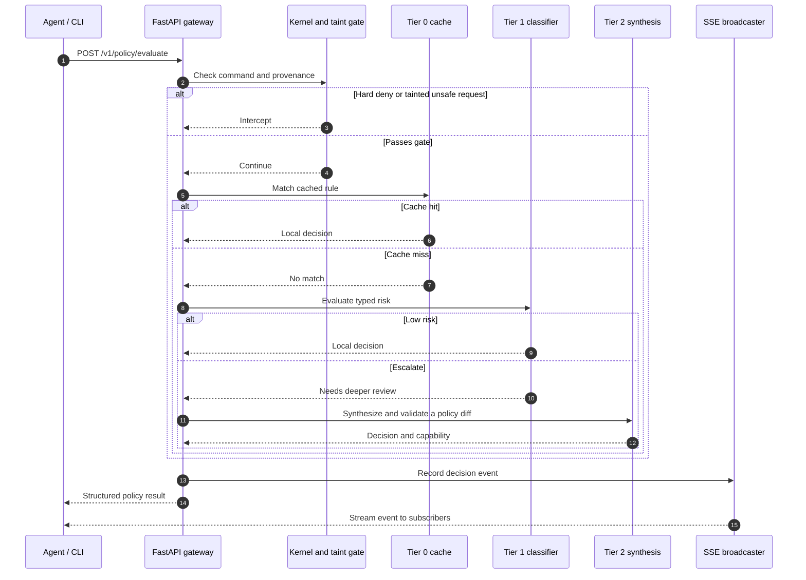

<p align="center">
  
</p>

<p align="center">
  <a href="https://youtu.be/8UN4cxzTTTA"></a>
  <a href="documentation/assets/parole-master-deck.pdf"></a>
  
  
</p>

<p align="center">
  <strong>Autonomous Least-Privilege Governor for AI Agents</strong><br>
  A policy gateway that routes agent actions through fast local checks before escalating uncertain decisions.
</p>

---

**PAROLE** explores a practical answer to a difficult agent-security trade-off: how can routine work stay fast without letting an agent turn a broad permission request into lasting access? It combines provenance-aware policy checks, a local rule cache, typed risk evaluation, and an optional NVIDIA-hosted policy-synthesis tier.

> **Project status:** research and hackathon prototype. This repository is not a production sandbox, OS-level isolation product, or independent security certification. Review the [security notes](#security-and-scope) before relying on any decision.

## At a glance

- **Fast path:** check requests against a local in-memory policy cache.
- **Risk path:** evaluate cache misses with a deterministic, typed risk classifier.
- **Escalation path:** optionally request a scoped policy proposal from NVIDIA Nemotron models, then validate the candidate rule locally.
- **Observable decisions:** expose policy events over Server-Sent Events (SSE), along with health and metrics endpoints.
- **Replayable evaluation:** run the repository's generated 1,000-trace benchmark and inspect the committed results.

## Architecture



Tier 2 can use NVIDIA's OpenAI-compatible API when `NVIDIA_API_KEY` is present; without it, the prototype's local fallback produces a **simulated** result. A verified proposal is not the same as a production authorization boundary: see [security and scope](#security-and-scope).

### A request, end to end



## See PAROLE

<p align="center">
  <a href="https://youtu.be/8UN4cxzTTTA">
    
  </a>
  <br>
  <a href="https://youtu.be/8UN4cxzTTTA"><strong>▶ Watch the project video</strong></a>
  &nbsp;·&nbsp;
  <a href="documentation/assets/parole-master-deck.pdf"><strong>View the Nebius × NVIDIA master deck (PDF)</strong></a>
</p>

## Benchmark snapshot

The checked-in [`BENCHMARK_REPORT.md`](BENCHMARK_REPORT.md) records the current benchmark artifact. These are **repository-local replay results**, not a third-party audit or a promise of production performance.

| Metric | Reported result | How to interpret it |
| --- | ---: | --- |
| Policy-resolution p95 | **0.123 ms** | In-process run; 200 warmups and 1,000 timed evaluations |
| Adversarial traces blocked | **100%** | Generated benchmark cases; 150 adversarial traces |
| Benign trace accuracy | **98.24%** | Generated benchmark cases; 850 benign traces |
| Estimated cost per 1,000 actions | **$0.28** | Modelled benchmark estimate, not a provider invoice |
| Escalation rate at minute 20 | **3.8%** | Replay/simulation output, not a user study |

The benchmark dataset is generated by [`benchmarks/run_benchmark.py`](benchmarks/run_benchmark.py). The checked-in cost estimates are historical benchmark assumptions and do not represent current NVIDIA API pricing. Results are useful for reproducing this prototype's behavior; they do not establish protection against unknown attacks, production latency, real-world approval reduction, or independently validated model quality.

## Get started

### 1. Install

Requires Python 3.11 or newer.

```bash
git clone https://github.com/SOHAM-RAJHANS/parole-1.git
cd parole-1
python -m venv .venv
```

Activate the virtual environment, then install the dependencies:

```bash
# macOS / Linux
source .venv/bin/activate

# Windows PowerShell
.\.venv\Scripts\Activate.ps1

python -m pip install -r requirements.txt
```

### 2. Run the API

```bash
python -m uvicorn backend.main:app --host 127.0.0.1 --port 8000
```

The interactive API reference is available at [http://127.0.0.1:8000/docs](http://127.0.0.1:8000/docs). The gateway binds to loopback in this example.

### 3. Evaluate an action

In another terminal:

```bash
python parole_cli.py exec "git status"
```

The CLI uses the local API when it is available and has an in-process fallback. To try the HTTP endpoint directly in PowerShell:

```powershell
Invoke-RestMethod `
  -Uri http://127.0.0.1:8000/v1/policy/evaluate `
  -Method Post `
  -ContentType 'application/json' `
  -Body '{"command":"git status","provenance":"TRUSTED_USER"}'
```

### Optional: enable NVIDIA inference

Tier 2 reads `NVIDIA_API_KEY` from the process environment. NVIDIA's OpenAI-compatible endpoint defaults to `https://integrate.api.nvidia.com/v1`; override it with `NVIDIA_BASE_URL` only when using a different trusted NVIDIA endpoint. Set the key in your shell rather than writing a real key into source control:

```powershell
$env:NVIDIA_API_KEY = "your-key"
```

```bash
export NVIDIA_API_KEY="your-key"
```

Without a key, Tier 2 uses the prototype's fallback and returns a `simulated` capability. Keep real credentials out of commits, screenshots, logs, and issue reports.

## API surface

| Method | Endpoint | Purpose |
| --- | --- | --- |
| `POST` | `/v1/policy/evaluate` | Evaluate an agent action and return a structured decision |
| `GET` | `/v1/policy/stream` | Subscribe to decision and policy events over SSE |
| `POST` | `/v1/policy/approve-diff` | Validate and add a scoped rule to the local cache |
| `GET` | `/v1/metrics/summary` | Read current benchmark and session metrics |
| `GET` | `/` | Basic service health |
| `GET` | `/healthz` | Render health check |
| `GET` | `/health` | Check gateway health and contract version |
| `POST` | `/v1/demo/run-180s` | Run the demo sequence; intended for demonstration, not production |

API schemas live in [`backend/schemas.py`](backend/schemas.py), with the shared contract in [`contract.json`](contract.json).

## Run the checks

```bash
python -m pytest -q
```

To reproduce the in-process benchmark:

```bash
python benchmarks/run_benchmark.py --mode in_process
```

The benchmark runner writes result and telemetry artifacts in the repository. Review the diff before committing benchmark output.

## Deployment

### Render API

The root `render.yaml` configures the Python web service. For a manual Render setup, use:

| Setting | Value |
| --- | --- |
| Root Directory | repository root (`.`) |
| Build Command | `pip install -r requirements.txt` |
| Start Command | `uvicorn backend.main:app --host 0.0.0.0 --port $PORT` |

Set `PYTHON_VERSION` to `3.11.9`, `NVIDIA_API_KEY` as a secret, and `FRONTEND_ORIGIN` to the exact Vercel origin (for example, `https://your-project.vercel.app`). `NVIDIA_BASE_URL` defaults to `https://integrate.api.nvidia.com/v1`. Multiple allowed origins can be comma-separated. The backend has no cookie-based authentication, so CORS credentials are disabled.

Tier 2 limits outbound NVIDIA requests to 15 per rolling minute per backend process and falls back locally when the key is missing, a request fails/times out, or the limit is reached. This in-memory limit is not a global billing cap across multiple Render instances or restarts; configure provider-side usage limits as well.

### Vercel frontend

The Next.js app is in `frontend/`; set Vercel's Root Directory to `frontend`, Framework Preset to `Next.js`, and Build Command to `npm run build`. Set `NEXT_PUBLIC_API_URL` to the deployed Render service URL (for example, `https://parole-backend.onrender.com`). This variable is public by design and must contain only the backend URL—never an API key or token.

## Project layout

```text
.
├── assets/
│   └── parole-banner.svg             # README hero artwork
├── backend/
│   ├── kernel_guard.py               # Provenance and command policy gate
│   ├── tier0_cache.py                 # Local in-memory rule cache
│   ├── tier1_jev.py                   # Typed risk classifier
│   ├── tier2_nebius.py                # NVIDIA synthesis and local fallback
│   ├── schemas.py                     # API models and policy contract
│   └── main.py                        # FastAPI gateway and SSE routes
├── benchmarks/                        # Generated traces and benchmark runner
├── documentation/
│   ├── assets/                        # Presentation materials
│   ├── agents/                        # Module implementation guides
│   ├── prds/                          # Module specifications
│   └── *.md                           # Architecture, test, and project docs
├── frontend/public/                   # Fallback telemetry payloads
├── scripts/                           # Contract and workspace utilities
├── tests/                             # API, policy, and benchmark tests
├── parole_cli.py                      # Developer command-line client
└── requirements.txt                   # Python dependencies
```

## Security and scope

- **Prototype, not a sandbox:** the Python policy gateway evaluates requests. Running this API alone does not install or activate Landlock, seccomp, NemoClaw, or another OS isolation boundary.
- **Treat decisions as advisory:** do not use this repository as the sole control protecting credentials, production systems, or sensitive data.
- **Tainted input is not trusted:** requests marked `web/repo_payload` are handled as untrusted provenance by the policy logic. This is a prototype policy signal, not a substitute for isolating agent execution.
- **Know which mode ran:** inspect the returned `capability` (`live`, `replay`, or `simulated`) and the benchmark mode before interpreting results.
- **Protect provider credentials:** never commit API keys. `.env` and `.env.*` files are ignored by Git; verify `git status` before publishing.

The repository is provided for research and evaluation. Review the implementation and adapt it to a properly isolated, independently tested environment before any security-sensitive use.

## Contributors

Thank you to the contributors supporting PAROLE:

<p>
  <a href="https://github.com/Prachikaushik01"></a>
  <a href="https://github.com/purandhri5972"></a>
</p>

GitHub's repository contributor list is generated from actual commits and other qualifying contributions. These badges recognize the roles listed above; they do not alter GitHub's automatically generated contribution history.

## Documentation

- [Master PRD and architecture](documentation/00_MASTER_PRD.md)
- [Test specification](documentation/TEST_SPEC.md)
- [Risks and cut lines](documentation/RISKS_AND_CUT_LINES.md)
- [Benchmark report](BENCHMARK_REPORT.md)
- [Nebius × NVIDIA master deck (PDF)](documentation/assets/parole-master-deck.pdf)
- [Project video](https://youtu.be/8UN4cxzTTTA)
